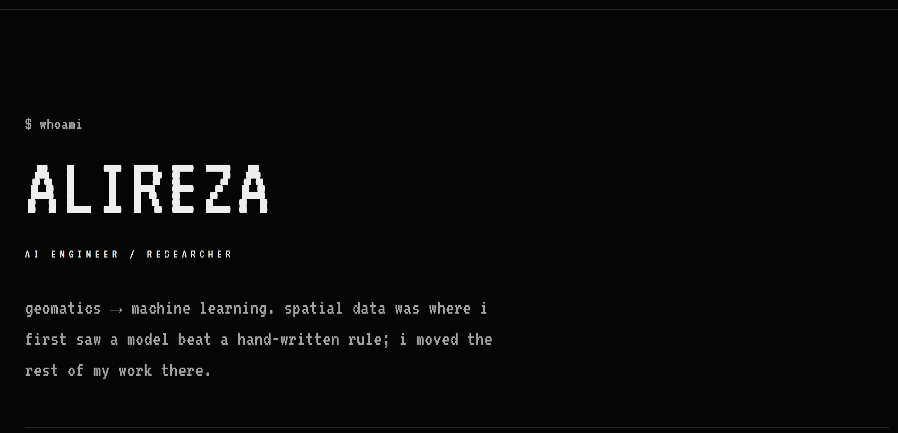

```console
$ cat location
tehran, iran   utc+03:30

$ ls ~/focus
models     prediction · classification · segmentation
vision     detection · visual content analysis
shipping   react/next in front, python/docker behind
```

---

### 01 / about

I came to machine learning through geomatics: surveying instruments, coordinate
systems, spatial data. GIS taught me that most hard problems are representation
problems — give the model the right frame and it stops fighting you.

What I do now is the whole path, not the notebook: data, training, evaluation,
deployment, and the part where a model has to stay correct after it ships.

---

### 02 / stack

```console
ai     pytorch · tensorflow · opencv · yolo
data   python · pandas · sql / nosql
web    react 18 · next.js · typescript · node.js
ops    docker · git · gcp / aws · mlops
```

---

### 03 / selected work

- **fraud detection** — e-commerce checkout risk scoring: a model and a rule
  engine produce one fraud score from behaviour, payment details, device
  fingerprints and velocity. the admin dashboard explains every flag with its
  top signals, rules replay against historical data, and chargeback outcomes
  feed retraining.
- **paas** — self-hosted platform-as-a-service: template deploys, BYO-VPS
  provisioning over SSH, k3s workloads, live service metrics. next.js + prisma
  in front, ssh/k3s agents behind.
- **market tooling** — solana trading bot and a chart/indicator bridge: signals
  from footprint and market structure, expectancy tracked per trade, not per
  hunch.
- **firmware work** — openwrt and qualcomm-edl reverse engineering on real
  hardware: partition layout, boot chain, recovery paths.
- **this page** — the portfolio behind the link below is a rust binary that
  emits one self-contained html file. no js, no bundler, no images.

---

### 04 / field

Internships, on site — before any of the model work.

```console
surveying   control networks · detail pick-up · cross sections
levelling   differential runs · benchmark transfer · closures
roads       centreline and cross-section stakeout
cadastral   parcel splitting · boundary computation
```

---

### 05 / links

```console
web     https://alirezamgh.vercel.app/
github  https://github.com/bubble666-ai
```

---

```console
$ exit
EOF
```
